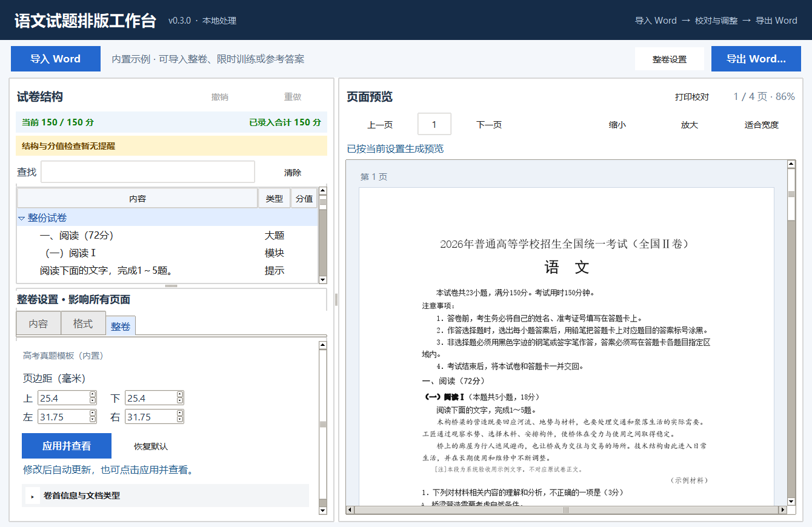

# 高中语文试卷智能排版工作台

<p align="center">
  
</p>

面向高中语文教师的 Windows 本地排版工具。把已有的 Word 试题（`.docx` / `.doc`）自动识别为卷首、阅读材料、题目、选项、诗歌、作文与答案，再按高考卷规范统一排版输出。

当前版本：**0.4.0**（Windows 64 位便携版，免安装，日常处理 `.docx` 不依赖 Office 或 WPS，所有内容仅在本机处理）。

[下载 Windows EXE](https://github.com/suoyikehahaha/chinese_exam_typesetter/releases/latest) · [更新记录](CHANGELOG.md) · [开发与发布](docs/development.md) · [反馈问题](https://github.com/suoyikehahaha/chinese_exam_typesetter/issues/new/choose)



## 核心特性

- **三栏清爽工作台**：左栏分层展示试卷大纲并自动汇总 150 分及缺分提醒；中栏提供“排版编辑 / 分页预览”双视图主舞台；右栏属性检查器可一键收起，方便专注审校。
- **像 Word 一样直接选字排版**：默认打开仿真 A4 纸面，支持直接点选、单段或跨段拖选文字并原地改字；选中后弹出浮动格式栏（也可用顶部快捷条），一键调整字体、字号、加粗、下划线、中文着重号、对齐方式与行距，支持清除局部格式与单步撤销。
- **多类组卷自然适配**：支持整套试卷、限时训练、独立参考答案及“题后附答案”，自动识别断句框、诗歌居中及不计分附加题，完整保留原文表格、图片、下划线与着重号，全部按内容自然分页。
- **打印校对与安全导出**：必要时可一键点击“打印校对”，调用本机 Word 或 LibreOffice 查看实际打印分页；导出时自动避开原文件名生成新 `.docx`，并保留未保存修改提醒与异常退出草稿恢复。
- **内置在线更新校验**：启动后静默检查 GitHub Releases，新版本下载需用户确认并自动核对 SHA-256 校验值。

## 快速上手

1. 在 [Releases 页面](https://github.com/suoyikehahaha/chinese_exam_typesetter/releases/latest) 下载便携版 `ChineseExamTypesetter_0.4.0.exe` 并直接运行（`Source code` 压缩包仅面向开发者）。
2. 点击“导入 Word”，或直接把 `.docx` / `.doc` 文件拖入窗口。
3. 在左栏大纲核对题目结构与分值；在中间仿真 A4 纸面上直接修改文字或选字调格式，也可使用右栏检查器批量统一同类对象格式或调整页边距。
4. 切至“分页预览”或点击“打印校对”确认无误后，点击“导出 Word”保存正式文档。

## 环境说明与当前范围

- **运行环境**：Windows 10 / 11（64 位）。建议系统已安装 **宋体、黑体、楷体、仿宋**；缺失字体会在界面提示，不建议带着字体警告直接印刷。
- **办公软件依赖**：`.docx` 导入、排版与快速预览无需 Office/WPS；仅导入旧版 `.doc` 或使用“打印校对”时，按需调用本机 Word、WPS 或 LibreOffice。
- **当前范围**：仅支持可编辑的 Word 文档并仅导出 `.docx`，暂不支持 PDF 导入/导出或扫描件 OCR。内部快速预览与编辑器画布用于日常校对，**最终印刷分页与复杂表格版式请以导出的 `.docx` 在 Word/WPS 中打开后的效果为准**。
- **下载校验**：发布页随附 `SHA256SUMS.txt`，可在 PowerShell 运行 `Get-FileHash .\ChineseExamTypesetter_版本号.exe -Algorithm SHA256` 核对文件完整性。

## 源码运行与打包

需要 Windows 64 位及 Python 3.11+（依赖见 `requirements-runtime.txt` 与 `requirements-build.txt`）：

```powershell
# 运行源码工作台
python -m venv .venv
.\.venv\Scripts\python.exe -m pip install -r requirements-runtime.txt
.\.venv\Scripts\python.exe windows_launcher.py

# 运行测试与构建便携 EXE
.\.venv\Scripts\python.exe -B -m pytest -q
.\.venv\Scripts\python.exe -m pip install -r requirements-build.txt
.\build_windows.ps1 -PythonPath .\.venv\Scripts\python.exe
```

模块结构、内部诊断与发布规范详见 [开发与发布说明](docs/development.md)。

## 使用许可与反馈

本工具由作者（公众号：蓑衣微言）面向高中语文教学制作，未经书面许可不得用于销售、出租、收费分发或商业营利，详情见 [使用许可](使用许可.md)。欢迎在 [GitHub Issues](https://github.com/suoyikehahaha/chinese_exam_typesetter/issues/new/choose) 反馈问题（附版本号与脱敏样例）。
